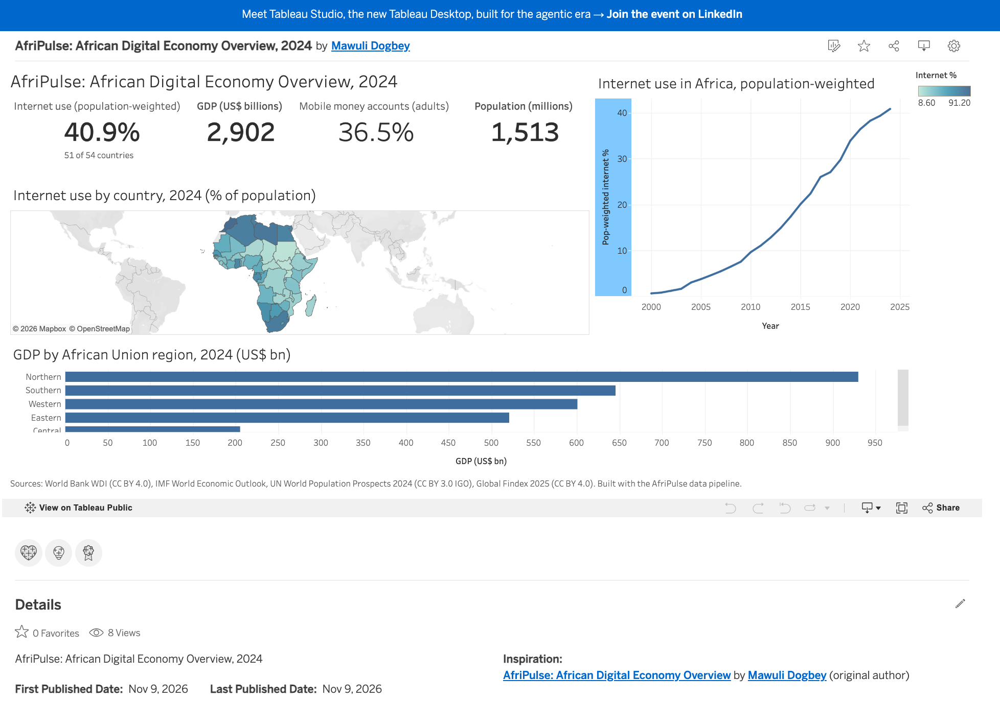

# AfriPulse

[](https://github.com/maolyd/afripulse/actions/workflows/ci.yml)

**An end-to-end data platform for Africa's digital economy:** public statistics from the
World Bank, IMF, UN and Global Findex are ingested, validated, modelled into a star schema
with dbt, orchestrated with Airflow, quality-scored daily, and published as six Tableau
Public dashboards. A calibrated synthetic dataset adds consumer, mobile money and loyalty
transactions that public sources do not provide.

> **Synthetic data notice:** every table, file and dashboard built from generated data is
> labelled SYNTHETIC. It is calibrated to real statistics but describes no real person,
> merchant or transaction.

**[View the live dashboards](https://public.tableau.com/app/profile/mawuli.dogbey/viz/AfriPulseAfricanDigitalEconomyOverview2024/Overview)**



---

## What it shows

| # | Dashboard | Data | Key finding |
|---|---|---|---|
| 1 | African Digital Economy Overview | REAL | 40.9% of Africans online in 2024 (51 of 54 countries reporting) |
| 2 | Country Comparison | REAL | IMF and World Bank GDP growth differ by more than 2 points in 99 country-years, mostly in fragile states |
| 3 | Mobile & Internet Adoption | REAL | 96 mobile subscriptions per 100 people but 41% online; fixed broadband about 3 per 100 |
| 4 | Mobile Money & Digital Payments | REAL + SYNTHETIC | Mobile-money-led inclusion (Kenya, Ghana) versus bank-led (South Africa, Egypt) |
| 5 | Retail & Consumer Transactions | SYNTHETIC | Month-end uplift of 31%, validated against the generator's x1.3 setting |
| 6 | Customer Loyalty Analytics | SYNTHETIC | Points reconcile exactly; 26.7% breakage leaves a 5.8m-point liability |

Links, screenshots and findings for every dashboard: [`tableau/dashboard_links.md`](tableau/dashboard_links.md)

## Architecture

```
Sources ──> Python ingestion ──> PostgreSQL ──> dbt ──> reporting extracts ──> Tableau Public
(World Bank,   (retries, pre-load    (raw JSONB,    (staging, intermediate,
 IMF, UN WPP,   validation,           raw_synthetic,  star-schema marts,
 Findex)        idempotent upsert)    audit)          SCD2 snapshot, tests)
        Airflow orchestrates every step daily; a data quality report scores each run.
```

- Full diagram and design table: [`docs/architecture/system_overview.md`](docs/architecture/system_overview.md)
- Warehouse model: [`docs/architecture/warehouse_erd.md`](docs/architecture/warehouse_erd.md)
- dbt lineage: [`docs/architecture/dbt_lineage.png`](docs/architecture/dbt_lineage.png)

## Engineering highlights

- **Idempotent, incremental ingestion.** Every load is an upsert that rewrites a row only
  when its hash changes. Each source detects change its own way: row hashes (World Bank),
  release detection (IMF WEO), file checksums (UN WPP, Findex), and a settings fingerprint
  (synthetic). Re-running the pipeline is always safe.
- **Validation before loading.** Duplicate keys, aggregate codes posing as countries, row-count
  drops, out-of-range years and coverage gaps are checked before anything is written. Errors
  block the load; every result is stored in `audit.validation_results`.
- **Kimball star schema in dbt.** Conformed dimensions, role-playing and degenerate dimensions,
  an unknown member, incremental facts with stale-row cleanup, and an SCD2 snapshot of
  World Bank income groups.
- **Discovery before modelling.** Fifty documented findings (for example: aggregates mixed into
  country lists, Namibia's code `NA` read as a null by pandas, UN counts in thousands, unlabelled
  IMF projections) each drive a rule in code. See [`docs/discovery/`](docs/discovery/).
- **Defence in depth on data quality.** The loyalty rule *points earned - points redeemed = points
  held* is checked in Python before loading, in dbt after transformation, and in Tableau in the
  final report. The dbt test caught a real generator bug, fixed in generator v2.
- **One quality status per run.** Ingestion, validation, dbt tests, source freshness and coverage
  combine into GREEN / AMBER / RED, stored in `audit.dq_reports`.
- **Resilient orchestration.** Two layers of retries (HTTP backoff of 2, 4, 8 and 16 s inside a
  task; Airflow retries after 10 then 20 minutes), alerts only after the final retry, and a
  quality report that runs even when upstream tasks fail.
- **Security.** Least-privilege PostgreSQL roles (app, dbt, read-only), SCRAM authentication,
  secrets only in environment variables, never in Git.
- **Calibrated synthetic data.** Deterministic (fixed seed), calibrated to real population,
  income and Findex statistics, guarded by invariant checks, and validated in the dashboards
  against the generator's own settings.

## Tech stack

Python 3.12 (requests, tenacity, pandas, SQLAlchemy, pydantic) · PostgreSQL 16 · dbt Core 1.11 ·
Apache Airflow 3 · Tableau Public · pytest · ruff · GitHub Actions. Runs natively on macOS
(no Docker), including a 2015 Intel MacBook.

## Data sources

| Source | Content | Licence |
|---|---|---|
| World Bank API (WDI) | Income, internet, mobile, broadband, urbanisation | CC BY 4.0 |
| IMF World Economic Outlook | GDP growth and inflation, including projections | IMF terms of use |
| UN World Population Prospects | Population and demography | CC BY 3.0 IGO |
| Global Findex Database 2025 | Account ownership, mobile money, borrowing | CC BY 4.0 |

Details and lineage: [`docs/source_catalogue.md`](docs/source_catalogue.md)

## Quick start (macOS, no Docker)

Prerequisites: Python 3.12, PostgreSQL 16 (for example Postgres.app), Git.

```bash
git clone git@github.com:maolyd/afripulse.git && cd afripulse
python3.12 -m venv .venv && source .venv/bin/activate
python -m pip install -e ".[dev,transform]"
cp .env.example .env        # then fill in your own database credentials
make db-setup               # database, roles, schemas and raw tables
make pipeline               # ingest, freshness check, dbt build, quality report
make export-tableau         # CSV extracts for Tableau in exports/tableau/
```

UN WPP and Global Findex are manual downloads; `config/sources.yml` names the files and pages.
Run `make help` to list every command.

**Orchestration (optional):** `make airflow-install`, `make airflow-init`, then `make airflow-start`
(UI on http://localhost:8080).

## Documentation

| Topic | Document |
|---|---|
| Source discovery findings | [`docs/discovery/`](docs/discovery/) |
| Source-to-target mapping | [`docs/source_to_target_mapping.md`](docs/source_to_target_mapping.md) |
| Data dictionary | [`docs/data_dictionary.md`](docs/data_dictionary.md) |
| Synthetic data design | [`docs/synthetic_data.md`](docs/synthetic_data.md) |
| Data reliability and runbook | [`docs/data_reliability.md`](docs/data_reliability.md) |
| Dashboard specifications | [`docs/dashboards.md`](docs/dashboards.md) |
| Architecture decisions | [`docs/adr/`](docs/adr/) |
| Challenges and solutions | [`docs/challenges_and_solutions.md`](docs/challenges_and_solutions.md) |
| Interview demo guide | [`docs/demo_guide.md`](docs/demo_guide.md) |

## Project phases

| Phase | Content | Tag |
|---|---|---|
| 1–2 | Setup, source discovery | |
| 3 | Ingestion and validation | v0.3.0 |
| 4 | Synthetic data | v0.4.0 |
| 5 | dbt warehouse | v0.5.0 |
| 6–7 | Airflow orchestration, data quality reporting | |
| 8 | Tableau Public dashboards | v0.8.0 |
| 9 | Portfolio and CI | v1.0.0 |