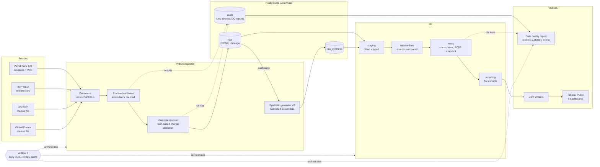

# AfriPulse system overview

How data flows from public sources to the published dashboards. Every arrow is a
step that is automated, logged, and checked.

| Layer | Technology | Key design decision |
|---|---|---|
| Ingestion | Python, requests, tenacity, pandas | Raw payloads kept as JSONB, so a source change never loses data |
| Validation | Custom checks, `audit.validation_results` | Errors block a load before anything is written |
| Storage | PostgreSQL 16, least-privilege roles | Separate `raw`, `raw_synthetic` and `audit` schemas |
| Transformation | dbt Core 1.11 | Kimball star schema; incremental facts; SCD2 snapshot of income groups |
| Orchestration | Airflow 3 (separate virtual environment) | Airflow only orchestrates: tasks call the project's own CLI and Makefile |
| Quality | dbt tests, freshness, coverage | One GREEN / AMBER / RED status stored in `audit.dq_reports` |
| Reporting | CSV extracts, Tableau Public | Synthetic files and dashboards always carry a SYNTHETIC label |
| CI | GitHub Actions | Lint and unit tests on every push |

See also: [warehouse ERD](warehouse_erd.md) · [source catalogue](../source_catalogue.md) ·
[data reliability](../data_reliability.md)