# Warehouse Design: Star Schema (marts)

The analytical layer is a **star schema**: fact tables of measurable events or
observations, surrounded by dimension tables that describe them. Built by dbt
(Phase 5) in the `marts` schema from the `raw` and `raw_synthetic` layers.
Design rationale: [ADR 0002](../adr/0002-dimensional-model.md).
Column definitions: [data dictionary](../data_dictionary.md).

## Entity-relationship diagram

```mermaid
erDiagram
    dim_country ||--o{ fact_economic_indicators : "country_key"
    dim_indicator ||--o{ fact_economic_indicators : "indicator_key"
    dim_source ||--o{ fact_economic_indicators : "source_key"
    dim_country ||--o{ fact_digital_adoption : "country_key"

    dim_date ||--o{ fact_retail_transactions : "date_key"
    dim_country ||--o{ fact_retail_transactions : "country_key"
    dim_customer ||--o{ fact_retail_transactions : "customer_key"
    dim_merchant ||--o{ fact_retail_transactions : "merchant_key"
    dim_payment_method ||--o{ fact_retail_transactions : "payment_method_key"

    dim_date ||--o{ fact_mobile_money : "date_key"
    dim_country ||--o{ fact_mobile_money : "country_key"
    dim_customer ||--o{ fact_mobile_money : "customer_key (sender)"
    dim_customer ||--o{ fact_mobile_money : "counterparty_customer_key"
    dim_merchant ||--o{ fact_mobile_money : "merchant_key"

    dim_date ||--o{ fact_loyalty_transactions : "date_key"
    dim_country ||--o{ fact_loyalty_transactions : "country_key"
    dim_customer ||--o{ fact_loyalty_transactions : "customer_key"

    fact_economic_indicators {
        text country_key FK
        text indicator_key FK
        text source_key FK
        int year
        numeric value
        boolean is_projection
        boolean is_default_source
        boolean sources_disagree
    }
    fact_digital_adoption {
        text country_key FK
        int year
        numeric internet_users_pct
        numeric mobile_subscriptions_per_100
        numeric account_ownership_pct
        numeric mobile_money_account_pct
        numeric population_total
    }
    fact_retail_transactions {
        text txn_id PK "degenerate dimension"
        int date_key FK
        text country_key FK
        text customer_key FK
        text merchant_key FK
        text payment_method_key FK
        timestamp txn_ts
        numeric amount_usd "additive"
        int item_count "additive"
    }
    fact_mobile_money {
        text mm_txn_id PK "degenerate dimension"
        int date_key FK
        text country_key FK
        text customer_key FK
        text counterparty_customer_key FK "role-playing"
        text merchant_key FK "unknown member if none"
        text txn_type
        text status
        numeric amount_usd "additive"
        numeric fee_usd "additive"
    }
    fact_loyalty_transactions {
        text event_id PK "degenerate dimension"
        int date_key FK
        text country_key FK
        text customer_key FK
        text event_type
        int points_earned "additive"
        int points_redeemed "additive"
        int balance_after "semi-additive"
    }
    dim_country {
        text country_key PK
        text country_iso3 UK
        text country_name
        text au_region
        text income_group_name
    }
    dim_indicator {
        text indicator_key PK
        text indicator_code UK
        text unit
        text theme
        text default_source_id
    }
    dim_source {
        text source_key PK
        text source_id UK
        text provider
        text licence
        boolean is_synthetic
    }
    dim_date {
        int date_key PK "YYYYMMDD"
        date calendar_date
        int year
        int month
        boolean is_weekend
        boolean is_month_end_window
    }
    dim_customer {
        text customer_key PK
        text customer_id UK
        text country_iso3 "attribute, not FK"
        text age_band
        boolean has_mobile_money
        boolean is_loyalty_member
    }
    dim_merchant {
        text merchant_key PK
        text merchant_id UK
        text category
        boolean accepts_card
        boolean accepts_mobile_money
    }
    dim_payment_method {
        text payment_method_key PK
        text payment_method_code UK
        text payment_method_name
        boolean is_digital
    }
```

## Bus matrix (which dimensions each fact uses)

A Kimball **bus matrix** shows the shared ("conformed") dimensions that let facts
be compared with each other. For example, `dim_country` links real economic
data to synthetic transactions, so a dashboard can put Kenya's real mobile money
share next to synthetic mobile money volumes.

| Fact \ Dimension | country | date | indicator | source | customer | merchant | payment method |
|---|:-:|:-:|:-:|:-:|:-:|:-:|:-:|
| `fact_economic_indicators` | ✓ | year | ✓ | ✓ | | | |
| `fact_digital_adoption` | ✓ | year | | | | | |
| `fact_retail_transactions` | ✓ | ✓ | | | ✓ | ✓ | ✓ |
| `fact_mobile_money` | ✓ | ✓ | | | ✓ ×2 | ✓ | |
| `fact_loyalty_transactions` | ✓ | ✓ | | | ✓ | | |

## Grain of every fact table

| Fact | Grain: one row per… | Type | Rows (approx.) |
|---|---|---|---|
| `fact_economic_indicators` | country × year × indicator × source (latest release) | Periodic snapshot | ~25,000 |
| `fact_digital_adoption` | country × year (default sources, actuals only) | Periodic snapshot, derived | ~1,400 |
| `fact_retail_transactions` | retail purchase | Transaction | ~210,000 |
| `fact_mobile_money` | mobile money wallet transaction | Transaction | ~280,000 |
| `fact_loyalty_transactions` | loyalty event (points earned or redeemed) | Transaction | ~160,000 |

## Measures and additivity

| Measure | Fact | Additivity | Meaning for dashboards |
|---|---|---|---|
| `amount_usd`, `item_count` | retail | Additive | Sum across any dimension |
| `amount_usd`, `fee_usd` | mobile money | Additive | Sum across any dimension (filter `status = 'completed'`) |
| `points_earned`, `points_redeemed` | loyalty | Additive | Sum across any dimension |
| `balance_after` | loyalty | **Semi-additive** | Never sum over time: take the latest per customer, then sum across customers |
| `value` | economic indicators | **Non-additive** | Percentages and per-capita values cannot be summed; average with population weights |

## Physical design (PostgreSQL)

| Element | Choice |
|---|---|
| Schemas | `staging` (views), `intermediate` (views), `marts` (tables) |
| Surrogate keys | `md5` hash of the natural key (`dbt_utils.generate_surrogate_key`): stable across full rebuilds |
| Unknown member | Each dimension has a row with key `'-1'` ("Not applicable"), so facts never hold null foreign keys |
| Primary keys | Tested by dbt (`unique`, `not_null`); enforced with unique indexes |
| Foreign keys | Tested by dbt `relationships` tests |
| Indexes | B-tree on every fact foreign key used in filters (`date_key`, `country_key`, `customer_key`, `merchant_key`); unique index on each dimension's natural key |
| Incremental | Transaction facts built incrementally by dbt; annual facts and dimensions rebuilt in full (small) |
| Access | `afripulse_reader` (Tableau) granted `SELECT` on `marts` only |
