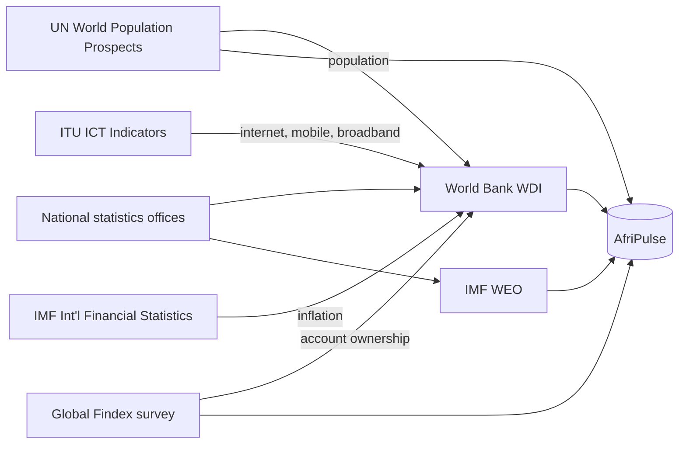

# AfriPulse Source Catalogue

The authoritative list of data sources used by AfriPulse. Machine-readable
settings live in [`config/sources.yml`](../config/sources.yml); detailed
discovery findings are linked per source.

Last verified: 2026-11-07 with `scripts/explore/verify_sources.py` (all sources OK).

## Sources in scope

| ID | Provider | Access | Format | Release | Licence | Coverage | Frequency | Raw table |
|---|---|---|---|---|---|---|---|---|
| `worldbank_countries` | World Bank | REST API | JSON | live | CC BY 4.0 | 217 economies + 79 aggregates | Ad hoc (income groups each July) | `raw.worldbank_countries` |
| `worldbank_wdi` | World Bank (WDI) | REST API, paginated | JSON | live (last updated 2026-10-08) | CC BY 4.0 | 54 countries, 2000+ | Annual | `raw.worldbank_indicator_values` |
| `imf_weo` | IMF (World Economic Outlook) | REST API (DataMapper) | JSON | WEO October 2026 | IMF Copyright and Usage terms (to confirm) | 54 countries, 1980–2031 | Twice yearly (Apr, Oct) | `raw.imf_weo_values` |
| `un_wpp` | UN DESA Population Division | Manual download | CSV | WPP 2024 | CC BY 3.0 IGO | 54 countries, 1950–2100 | Biennial | `raw.un_wpp_demographic_indicators` |
| `findex` | World Bank (Global Findex) | Manual download | Excel | Findex 2025 | CC BY 4.0 | 48 of 54 countries, waves 2011–2024 | Survey every ~3 years | `raw.findex_values` |

All sources collected or verified on **2026-11-07**.

## Lineage: where the numbers really come from

**Implications**

- Agreement between WB population and UN WPP is *not* independent confirmation (F-UN-2).
- WB inflation (`FP.CPI.TOTL.ZG`) originates at the IMF; IMF and WB GDP are independent compilations of national data (F-IMF-8).
- ITU data reaches AfriPulse via the World Bank; direct ITU ingestion is deferred.

## Known limitations (summary)

| Source | Main limitations | Details |
|---|---|---|
| World Bank | Aggregates mixed with countries; publication lag of 1–2 years; fragile states lag years behind; untrimmed text | [findings](discovery/worldbank_findings.md) |
| IMF | Projections unlabelled; values revised each release; CDN blocks custom User-Agents | [findings](discovery/imf_findings.md) |
| UN WPP | Counts in thousands; projections unlabelled; 57% of rows are aggregates; pandas erases Namibia's ISO2 by default | [findings](discovery/un_wpp_findings.md) |
| Findex | Survey waves only; fractions not percent; multiple demographic rows per country-year; 6 African countries never surveyed | [findings](discovery/findex_findings.md) |

## Defined scope

- **Countries:** 54 African Union member states recognised by the UN ([ADR 0001](adr/0001-definition-of-africa.md)).
- **Default source per indicator** (to be finalised in the data dictionary): IMF for GDP growth and inflation; UN WPP for demographics; World Bank for GDP levels, connectivity and account ownership; Findex for mobile money and demographic breakdowns.

## Deferred / out of scope

| Source | Reason | Revisit |
|---|---|---|
| ITU DataHub (direct) | Core indicators already arrive via WB; would duplicate data | Phase 9 enhancement (mobile broadband, gender splits) |
| GSMA | Mostly paid or PDF-only; used only as reference values for synthetic calibration | Phase 3 (synthetic data) |
| IMF Financial Access Survey | Access route changed; mobile money agents/transactions | Future enhancement |
| Western Sahara | No data in most sources | ADR 0001 |

## Synthetic data

Synthetic customers, merchants, transactions and loyalty data will be generated
in Phase 3 and stored separately in the `raw_synthetic` schema. It is **never**
presented as real-world observation.

## Open actions

- [ ] Confirm IMF licence and attribution wording.
- [ ] Confirm UN WPP footnote texts for TZA and MUS.
- [ ] Decide projection flag method for IMF (rule of thumb vs bulk WEO file).